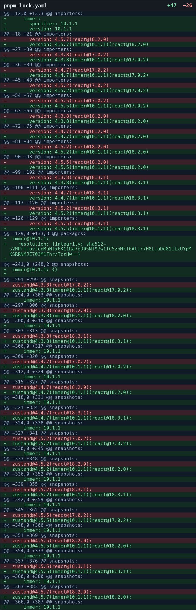
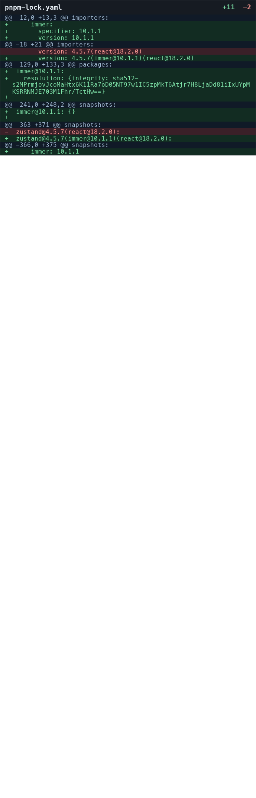

# locksmith

<div align="center">

|                                                                                          `pnpm install`                                                                                           |                                                                               `locksmith converge HEAD`                                                                                |
| :-----------------------------------------------------------------------------------------------------------------------------------------------------------------------------------------------: | :------------------------------------------------------------------------------------------------------------------------------------------------------------------------------------: |
| [](examples/converge/installed/pnpm-lock.yaml) | [](examples/converge/converged/pnpm-lock.yaml) |

</div>

Locksmith merges pnpm lockfiles and keeps unrelated dependency changes out of your diff.

When `pnpm-lock.yaml` conflicts during a merge or rebase, regenerating it can change unrelated versions and peer bindings. Even with the original lockfile in place, a dependency edit can change how pnpm resolves peers in other workspace projects.

Locksmith works directly on the lockfile graph and preserves versions and peer bindings that still fit. It works offline by default and returns the original bytes when the lockfile needs no changes.

| Starting point                                                                      | Command                                        |
| ----------------------------------------------------------------------------------- | ---------------------------------------------- |
| Two branches changed the lockfile                                                   | [`merge`](#merge-two-branches)                 |
| You edited dependencies and `pnpm install` changed more than you expected           | [`converge`](#reduce-changes-after-an-install) |
| Git already merged the lockfile, but some records are duplicated, stale, or missing | [`repair`](#repair-an-already-merged-lockfile) |

## Install

Install the Node.js API and CLI as a project dependency. The package provides prebuilt binaries for Node.js 22 and later on macOS, Windows, and Linux (glibc and musl), on x64 and arm64.

```sh
pnpm add -D es-locksmith
pnpm exec locksmith --help
```

You can also install the CLI on macOS or Linux with Homebrew.

```sh
brew tap sec-ant/locksmith https://github.com/Sec-ant/locksmith.git
brew install sec-ant/locksmith/locksmith
```

To install from a checkout with Rust 1.89 or later, run `cargo install --locked --path crates/locksmith-cli` from the repository root.

Locksmith supports `lockfileVersion: '9.0'`, the default in pnpm 9–12.

## Agent skill

The [Locksmith skill](skills/locksmith/SKILL.md) guides lockfile merges, repairs, and convergence. Install the CLI above and add `skills/locksmith/` to your agent's skills.

Try asking “Resolve the `pnpm-lock.yaml` conflict in this rebase.” The skill uses workspace context when available and enables registry lookups as needed. Say “offline” to skip them.

## Merge two branches

Pass the common ancestor, your lockfile, and the other branch's lockfile in that order. This command works outside a Git repository.

```sh
locksmith merge base.yaml ours.yaml theirs.yaml > merged.yaml
```

If both branches changed the same dependency, the final workspace manifests decide which version to keep. The Git driver collects them automatically. Scripts can supply the same information with `--context FILE`; see [Merge context](docs/design.md#merge-context). Without context, Locksmith performs a three-way comparison and reports a conflict when a reachable record disagrees.

### Configure the Git merge driver

Add this line to the repository's `.gitattributes`.

```gitattributes
/pnpm-lock.yaml merge=locksmith
```

Register the driver once per clone with Git 2.38 or later.

```sh
git config merge.locksmith.driver 'locksmith merge --git-driver %O %A %B %P'
```

Git now calls Locksmith during merges and rebases when the lockfile needs a three-way merge. The driver reads the merged workspace declarations, selects records against them, and prefers the mainline version when both pins fit equally well.

The driver uses `origin/HEAD` by default. To use another mainline, set `locksmith.mainline` in your clone. If neither is available, ties keep `ours`.

```sh
git config --local locksmith.mainline refs/heads/trunk
```

If Git pauses on the lockfile, resolve any project files named in the diagnostic, then open `pnpm-lock.yaml`. Resolve any conflict markers. If the text merged cleanly, review the dependency named in the diagnostic. Stage the resolved files with `git add` and continue the merge or rebase.

## Reduce changes after an install

After editing dependencies or upgrading pnpm, run your usual `pnpm install`. From the workspace root, pass the Git ref that holds the lockfile and workspace declarations from before your edit.

```sh
locksmith converge origin/main > converged.yaml
git diff --no-index pnpm-lock.yaml converged.yaml
```

The baseline lockfile and the installed lockfile must each match the manifests and settings they were generated from. Locksmith keeps the changes your edit requires and restores earlier versions and peer bindings where the new declarations still accept them. See the [convergence design](docs/design.md#4-converge) for the selection rules and a worked example.

Review the diff and replace `pnpm-lock.yaml` with `converged.yaml`.

## Repair an already merged lockfile

A clean Git merge can still leave a duplicate record, a stale importer declaration, or a dependency pointing to a missing package instance. From the workspace root, check the committed lock against the manifests and settings at the same revision.

```sh
locksmith repair HEAD > repaired.yaml
git diff --no-index pnpm-lock.yaml repaired.yaml
```

A healthy lock comes back byte-for-byte. Repair preserves valid pins and can recover missing records from parent commits or, with `--allow-network`, from registry metadata. When a pnpmfile is active, repair asks for effective declarations before rewriting a workspace importer. If the available evidence leaves a dependency unresolved, the command reports it on stderr and leaves stdout empty.

## Scripting contract

- On success, the standalone commands write YAML to stdout.
- Diagnostics go to stderr.
- Exit code `1` means a conflict, an unresolved dependency choice, or an unmet peer requirement. Other errors use `2`.
- The Git driver returns `1` on failure and writes Git's text merge of the three inputs to the lockfile, so you can resolve the conflict manually. Even when the text merges cleanly, Git keeps the lock unmerged so you can review the reported dependency.

## Optional registry access

With a complete Git clone, Locksmith works offline by default. In a partial clone, Git may fetch missing objects from its remote. A contextual merge, `converge`, and `repair` can query the configured registry for package metadata with `--allow-network`. The CLI uses the project's registry settings and credentials, respects release-age and version-selection settings, and caches metadata for the command. Package installation remains pnpm's job.

## Node.js API

Use `convergeWorkspace` to compare a Git ref with an installed worktree. It returns the YAML for review and leaves the working tree untouched.

```js
import { convergeWorkspace } from 'es-locksmith'

const yaml = await convergeWorkspace('origin/main', { cwd: process.cwd() })
```

`repairWorkspace(ref, options)` reads a committed lockfile. Both workspace methods accept `cwd`, `signal`, and `allowNetwork` and use the bundled CLI. `getCliPath()` returns its executable path.

For in-memory work, `merge(base, ours, theirs, context?)`, `converge(baseline, candidate, changes, options?)`, and `repair(yaml, context)` use the Rust engine directly and return a promise for the resulting YAML. Supply workspace manifests, effective pnpm settings, patch contents and any registry evidence in the context. Pass raw YAML to a contextual merge or repair to allow duplicate-key recovery.

Use `parse(yaml)` to reuse a parsed lockfile across calls. `validate`, `dependencyClosure`, and `inspectPeers` check references, trace an importer, and report peer issues. In-memory errors expose a `code` and `details`, including conflict paths and requests for missing registry metadata. Both ESM and CommonJS are supported. [TypeScript API](npm/index.d.ts)

## Rust API

Add the library with `cargo add es-locksmith` and import it as `locksmith`. The package is available on [crates.io](https://crates.io/crates/es-locksmith).

Rust applications can call `merge`, `converge`, and `repair` with in-memory inputs, and apply peer policy with `inspect_peers`. The library performs no filesystem, network, Git, or package-manager operations; callers supply manifests, workspace configuration, and optional registry metadata.

```rust
use locksmith::{Lockfile, LockfileError, merge};

fn main() -> Result<(), LockfileError> {
    let base = Lockfile::parse("lockfileVersion: '9.0'\nimporters: {app: {}}\n")?;
    let ours = Lockfile::parse("lockfileVersion: '9.0'\nimporters: {app: {}, lib: {}}\n")?;
    let merged = merge(&base, &ours, &base, None)?;
    assert!(merged.project().unwrap()["importers"].get("lib").is_some());
    Ok(())
}
```

Run `cargo doc -p es-locksmith --no-deps --open` from a checkout for the full API. For the data model and algorithms, see [How Locksmith works](docs/design.md).

## Performance

Pull requests time `merge`, `converge`, and `repair` on a 314-project workspace derived from the README example. The fixture repeats one site's dependency graph 300 times. The base and PR builds take turns on the same GitHub runner. The benchmark job summary shows the median times and flags consistent slowdowns above the measured noise. [CodSpeed](https://app.codspeed.io/Sec-ant/locksmith) tracks simulated CPU work and memory on the same inputs. To time the commands locally, install hyperfine and run `just bench`.

## Compatibility and limits

- Supports `lockfileVersion: '9.0'`, the default in pnpm 9–12. Experimental lockfile formats are rejected by their format version.
- Locksmith never installs packages. Run `pnpm install` for that.
- The library performs no I/O. The CLI reads project files, Git, and the registry.
- Registry access is opt-in with `--allow-network`.
- The Git driver requires Git 2.38 or later.
- The output is validated before it is written; a failed operation produces no partial lockfile.

## Prepare a release

With Knope installed, run `just change` to record a user-facing change and its version bump in `.changeset/`. Commit that file with the change. When the changeset reaches `main`, Knope Bot opens or updates a release PR with the next version, `Cargo.lock`, and `CHANGELOG.md`. See the [changeset style guide](CONTRIBUTING.md#changesets).

Review and merge the release PR to publish. GitHub Actions builds the macOS and Linux binaries, publishes the release with its artifacts, updates the Homebrew formula, and publishes `es-locksmith` to crates.io and npm.
